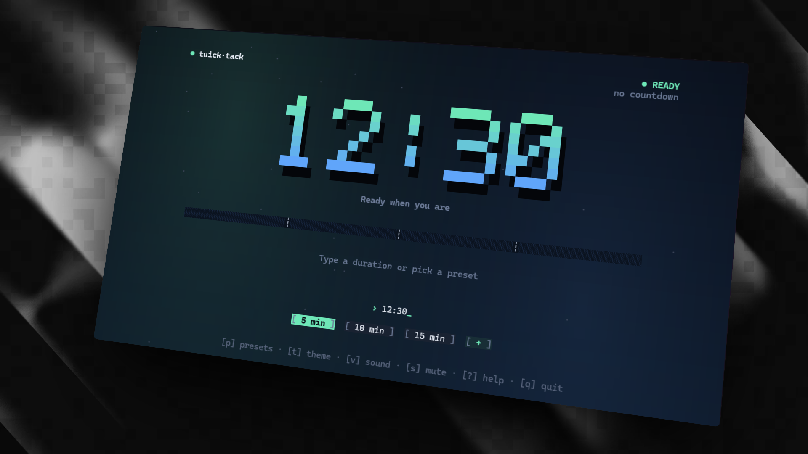

<div align="center">


**Your countdown, in the terminal and in the tray.**

Presets, free-form durations, a sound pack with volume, and full-screen confetti. Windows 10/11.

[](https://github.com/Juankyyy/tuick-tack/releases/latest)
[](LICENSE)
[](https://github.com/Juankyyy/tuick-tack/releases/latest)
[](https://go.dev/dl/)

[Download](#download) · [Features](#features) · [Controls](#controls) · [Tray](#tray) · [Configuration](#configuration) · [Architecture](#architecture) · [Development](#development)

</div>



## Download

[**Download the latest release for Windows**](https://github.com/Juankyyy/tuick-tack/releases/latest). There are two ways to use the same app:

- **Installer (recommended):** run `tuick-tack-setup.exe`. It installs for your user in
  `Documents\tuick-tack`, adds a Start Menu shortcut and registers an uninstaller in
  Windows Settings. No administrator rights.
- **Portable:** run `tuick-tack.exe` directly. A single file, no installer and no
  dependencies.

Both copies share `%APPDATA%\tuick-tack\config.json`, so presets, theme, sound, volume
and the remembered window size are the same if you switch between them. If an older Tuick-Tack is running, quit it from the
tray before running the setup for the first time. Windows 10 or 11, 64-bit. The build is
unsigned, so SmartScreen may warn on first launch. Check the download against `SHA256SUMS.txt`:

```powershell
Get-FileHash .\tuick-tack.exe -Algorithm SHA256
Get-FileHash .\tuick-tack-setup.exe -Algorithm SHA256
```

On first launch the TUI starts a hidden daemon and connects to it. Close the TUI and the
countdown, the sound and the tray icon keep running.

## Features

| Feature | What you get |
|---|---|
| **Presets** | 5, 10 and 15 minutes out of the box. Create, edit and delete your own. |
| **Free-form durations** | `25`, `12:30`, `90s`, `1h30m`, `1:02:03` — from one second to 24 hours. |
| **Full control** | Pause, resume, add or subtract a minute, and repeat. |
| **Always running** | The daemon owns the timer, so closing the TUI never stops a countdown. |
| **Tray menu** | Start a preset, pause, stop, change the sound or volume, and open the TUI. |
| **Statistics** | `s` opens a full-screen view with focus per day, a 26-week heatmap, time by hour and weekday, per-preset totals and the latest sessions. |
| **At zero** | The selected sound at the chosen volume, an alert tray icon and full-screen confetti. |
| **Sound pack** | Chime, Marimba, Digital and Deep; 0–100% volume in 5% steps, with preview and mute. |
| **Three themes** | Midnight, Ember and Mono. |
| **Remembers the window size** | Resize the terminal and the next TUI opens with the same columns and rows. |
| **Single instance** | Running the executable again focuses the open TUI instead of opening a second one. |
| **Installer** | Per-user install in `Documents\tuick-tack`, Start Menu shortcut, uninstaller; no admin. |
| **Portable** | One executable, no installer, no admin, no cgo. |
| **In-app updates** | Check with `u`; read what's new, then install with the setup or download the portable `.exe`. |
| **Version in the header** | The running TUI version follows the wordmark in a quiet tone. |

## Controls

| Context | Keys |
|---|---|
| Idle | Digits, `:`, `h`, `m`, `s` type a duration; `Backspace` deletes; `Enter` starts |
| Idle | `←` `→` select a preset; `p` presets; `t` theme; `v` sound settings; `m` mute; `s` statistics; `u` check/install update; `?` help; `q` close |
| Running | `Space` pause; `Esc` confirm cancel; `+` / `-` ±1 min; `v` sound settings; `m` mute; `s` statistics; `?` help; `q` close |
| Paused | `Space` resume; `Esc` confirm cancel; `+` / `-` ±1 min; `v` sound settings; `m` mute; `s` statistics; `?` help |
| Finished | `r` repeat; `v` sound settings; `m` mute; `s` statistics; `Enter` / `Esc` close the celebration |
| Statistics | `←` `→` or `Tab` switch section; `1`–`4` jump; `t` range (7/30/90 days or all time); `↑` `↓` `PgUp` `PgDn` `Home` `End` or the wheel scroll; `Esc` or `s` close |
| Sound panel | `↑` `↓` select the sound; `←` `→` volume ±5%; `Space` preview; `m` mute; `Esc` close |
| Presets panel | `↑` `↓` move; `Tab` actions; `←` `→` choose an action; `Enter` start or run; `a` add; `e` edit; `d` delete; `r` restore defaults; `Esc` close |
| Form | `Tab` next field; `Enter` save; `Esc` cancel |
| Update dialog | `↑` `↓` or `Tab` switch setup/portable; `←` `→` actions; `PgUp` `PgDn` scroll the release notes; `Enter` run; `g` GitHub; `Esc` later |

In the app, key hints use the `[key] action` format, for example `[Space] pause`.

Duration formats: `25` = 25 minutes · `12:30` = 12 min 30 s · `90s` · `1h30m` · `1:02:03`.
The accepted range is one second to 24 hours.

> In idle, `s` and `m` add a unit when the input already contains a number (`90s`, `25m`);
> on an empty (or otherwise incomplete) input, `s` opens Statistics and `m` toggles the sound.
> `v` opens the sound panel from any screen.

## Tray

Left click opens the TUI, or brings the open one to the front. Right click opens the menu.

```text
Tuick-Tack · 04:32 remaining
Check for updates
─────────────────────────────
Open Tuick-Tack
Start            ▸ 5 min · 10 min · 15 min · Custom…
Pause / Resume
Stop
Sound            ✓
Sound settings   ▸ Chime · Marimba · Digital · Deep · Preview
Volume 80%       ▸ -5% · +5% · 0% · 25% · 50% · 75% · 100%
Start with Windows
─────────────────────────────
Quit
```

The tray owns the timer. Closing the TUI leaves the countdown and the selected sound alive,
and **Quit** stops everything and closes any open TUI. A daemon restart loses the active
countdown; persistence is future work.

## Configuration

- **Presets, theme and sound settings:** `%APPDATA%\tuick-tack\config.json`
- **Session history for the Statistics tab:** `%APPDATA%\tuick-tack\history.jsonl`
- **Logs and sound cache:** `%LOCALAPPDATA%\tuick-tack\` (`sounds\`, `logs\`, `updates\`)
- **Installed copy:** `Documents\tuick-tack` when you use the installer; the uninstaller lives
  in the same folder and in Windows Settings. Uninstalling keeps your config and logs.
- **Portable copy:** wherever you saved `tuick-tack.exe`.
- **Autostart:** only if you enable it — `HKCU\Software\Microsoft\Windows\CurrentVersion\Run`,
  value `TuickTack`, pointing to `tuick-tack.exe --daemon --hidden`. No admin rights.
- **Notification identity:** `HKCU\Software\Classes\AppUserModelId\Juankyyy.TuickTack`
  (`DisplayName=Tuick-Tack`), registered the first time a Windows toast is shown. It is not app
  state; no admin rights.

```json
{
  "version": 3,
  "theme": "midnight",
  "sound": true,
  "sound_name": "digital",
  "volume": 80,
  "window_width": 140,
  "window_height": 45,
  "presets": [
    { "id": "p5",  "label": "5 min",  "seconds": 300 },
    { "id": "p10", "label": "10 min", "seconds": 600 },
    { "id": "p15", "label": "15 min", "seconds": 900 }
  ]
}
```

The daemon is the only writer and writes atomically. A corrupt config is backed up as
`config.bad-<timestamp>.json` and replaced with defaults. A version 1 config is migrated to
version 3 with Digital at 80%; a version 2 config keeps its sound and volume. The window
size stays unset until you resize the TUI.

The remembered size is columns by rows. It is restored when the TUI starts, including in
Windows Terminal; terminals that do not support the resize sequence keep their own size.
Position and the maximized state are not stored.

The daemon appends one line per finished countdown to `history.jsonl` (local time, planned and
real elapsed time, label and outcome: completed, stopped or replaced). It keeps the newest 2000
records and trims the file atomically; an unreadable file is backed up as
`history.bad-<timestamp>.jsonl` and the history starts empty. The Statistics tab reads a
precomputed summary over the pipe, so the TUI never parses the history. Nothing leaves the
machine and there is no telemetry.

### CLI flags

```text
tuick-tack --version
tuick-tack --check-updates
tuick-tack --install-startup
tuick-tack --uninstall-startup
tuick-tack --daemon            # background daemon with a console (development)
tuick-tack --daemon --hidden   # daemon without a console (used by autostart)
```

## Updates

The daemon checks the latest GitHub release once at startup and every 24 hours. When a newer
version exists, the TUI shows a moving pastel-rainbow `[Update available →]` after the wordmark
and its version. Clicking it, or pressing `u` once the release is known, opens the update
dialog: it shows `vCurrent → vLatest`, marks the copy you use and lets you install the setup or
download the portable `.exe`. The tray menu gets `Update available: vX.Y.Z`, which opens the
release page.

The dialog shows the copy you are using first, selected and marked `Installed` (setup) or
`In use` (portable). Use `↑`/`↓` or `Tab` to switch to the other type; if you choose it, the
dialog warns that it is not the copy you use and that your settings carry over. The horizontal
action row stays below: `install` or `download`, `github` and `later`.

When the release publishes notes, the dialog also opens a `What's new in vX` panel above the
type row: the first eight lines at 80×24 and sixteen at 120×40, with a scrollbar. Read the rest
with `PgUp`/`PgDn`, `Home`/`End` or the mouse wheel; `Tab` keeps switching the copy without
losing the scroll position. Releases without notes keep the shorter dialog.

- **Install update:** downloads `tuick-tack-setup.exe`, verifies it and runs the same
  per-user installer silently. The app closes, updates the copy in `Documents\tuick-tack`
  and reopens. If a countdown is running or paused, the TUI warns that the countdown will be
  lost before it continues.
- **Download portable:** downloads the new `tuick-tack.exe` into Downloads as
  `tuick-tack-vX.Y.Z.exe`, verifies it and leaves the current app running. Use it when you
  prefer the portable copy.

Feedback and safety:

- Nothing downloads until you confirm. The TUI shows download, verification and installation
  progress; a failed check or download keeps the old version and shows a short error.
- The daemon verifies the SHA-256 from the release asset digest or `SHA256SUMS.txt` before it
  runs or saves anything. A mismatch is discarded.
- The installed copy closes the daemon and the TUI gracefully, runs the installer with
  `/VERYSILENT` and reopens the TUI. The portable copy writes the new `.exe` to Downloads; it
  does not restart anything.
- The installer preserves an existing `Start with Windows` setting. User data in
  `%APPDATA%\tuick-tack` is never touched by an install, update or uninstall.
- The first release with this flow must be installed manually once by people on an older
  version. From then on, the TUI can update itself.
- One anonymous HTTPS request per check to `api.github.com`, with
  `User-Agent: tuick-tack/<version>` and no other identifiers. A failed check (offline, proxy,
  rate limit) is silent and retried after six hours. Asset downloads happen only after you
  confirm.
- The automatic check runs in release builds only (`dev` builds skip it); the manual check
  works in any build. `tuick-tack --check-updates` runs one check and prints the result.
- The installer is per-user and unsigned; SmartScreen can warn when you download it. There is
  no code signing yet.

## Architecture

```text
        one executable, two processes (both are tuick-tack.exe)
┌────────────────────────────┐  named pipe  ┌────────────────────────────────────┐
│ TUI (no arguments)         │◄────JSON────►│ daemon (--daemon)                  │
│ Bubble Tea v2              │    10 Hz     │ systray on the main goroutine      │
│ canvas + bigfont + fx      │              │ timer engine · IPC · config        │
│ keyboard, mouse, modals    │              │ PlaySoundW · PCM gain · autostart  │
└────────────────────────────┘              └────────────────────────────────────┘
```

- The daemon is the single source of truth. The TUI renders snapshots and interpolates
  locally for smoothness; it never keeps timer truth of its own.
- One named pipe per user and session; one daemon per session (named mutex).
- The pipe protocol is versioned. The TUI reconnects every second and disables commands
  while offline. The update messages are additive, so an older daemon or TUI still works.
- The daemon checks the latest GitHub release once a day, broadcasts it to the TUI and the
  tray, and downloads an update only when the TUI asks. The downloader verifies SHA-256; the
  setup path starts a short-lived helper and the portable path writes the `.exe` to Downloads.
- On finish the daemon increments `finish_seq` once, plays the selected sound at the
  configured volume and updates the tray; the TUI celebrates when it sees the new sequence.
- The daemon also records finished sessions and aggregates them for `get_stats`; the
  Statistics tab is a view over that summary and adds no timer truth of its own.

```text
cmd/tuick-tack        single entrypoint: TUI, daemon (--daemon) and update helper
internal/             engine, IPC, config, daemon, tray, TUI, stats, update, install metadata
installer/            Inno Setup script and branded wizard images
assets/               sounds, icons, banner and README screenshot
tools/                sound, icon, banner and installer-image generators
winres/               executable icon and version resources (.syso)
scripts/build.ps1     portable and installer release build
```

## Development

Requires Windows 10/11, Go 1.26+ and PowerShell 7. CGO is disabled, so no C compiler is needed.
Building the installer also needs Inno Setup 6 (`winget install -e --id JRSoftware.InnoSetup`).

```powershell
go mod download                  # install dependencies
go run ./cmd/tuick-tack          # TUI (starts the hidden daemon)
go run ./cmd/tuick-tack --daemon # daemon in the foreground
go test ./...                    # tests
go vet ./...                     # lint
go generate ./...                # regenerate sounds, icons, banner and .syso
```

### Build from source

```powershell
.\scripts\build.ps1                              # dev portable build into dist/
.\scripts\build.ps1 -Version v0.3.0              # release portable build
.\scripts\build.ps1 -Version v0.3.0 -Installer   # portable + setup + checksums
```

The script regenerates the assets, checks formatting, runs vet and the tests, and writes:

```text
dist/
  tuick-tack.exe
  tuick-tack-setup.exe   # with -Installer
  SHA256SUMS.txt
```

Run `dist\tuick-tack.exe` for the portable copy, or run `dist\tuick-tack-setup.exe` to
install it for the current user. Inno Setup is only needed to build the setup, not to run
the app.

- Behavior and full design: [`SPEC.md`](SPEC.md)
- Conventions and workflow: [`AGENTS.md`](AGENTS.md)

## Troubleshooting

| Symptom | What to check |
|---|---|
| TUI cannot connect | The TUI starts the daemon itself; check `%LOCALAPPDATA%\tuick-tack\logs\tuick-tack.log`. |
| No sound | Check the Windows volume and output device, that **Sound** is checked in the tray, and that the selected sound is not at 0%. The countdown still finishes visually. |
| Tray icon missing | Windows hides new tray icons; open the overflow chevron. |
| Very small window | Below 48×22 the TUI switches to a plain-text compact view (clock, label, state and essential keys); the styled layout returns above that size. |
| Presets disappeared | A corrupt config is backed up and defaults are restored. Look for `config.bad-*.json` in `%APPDATA%\tuick-tack`. |
| No update notice | Release builds check once at startup and every 24 h; `dev` builds do not. Run `tuick-tack --check-updates` and check the daemon log. |
| No Windows notification | Check **Settings > System > Notifications** for Tuick-Tack and turn off Focus Assist. The tray entry still shows the result. |
| Update download fails | Check the daemon log in `%LOCALAPPDATA%\tuick-tack\logs\tuick-tack.log`. The old version stays installed; open the release page and retry. |
| Update setup fails | The helper logs to `%LOCALAPPDATA%\tuick-tack\logs\update.log` (the Inno log is `setup.log` next to it). The previous copy is reopened when possible. |
| Update lost a countdown | The TUI warns before restarting when a timer is running or paused; the timer lives in memory and is not restored. |
| SmartScreen warning | Expected for an unsigned executable and installer. |
| Timer lost after a crash | The timer lives in memory; restart the daemon and start again. Persistence is out of scope for this release. |

## License

GPL-3.0. See [`LICENSE`](LICENSE).
